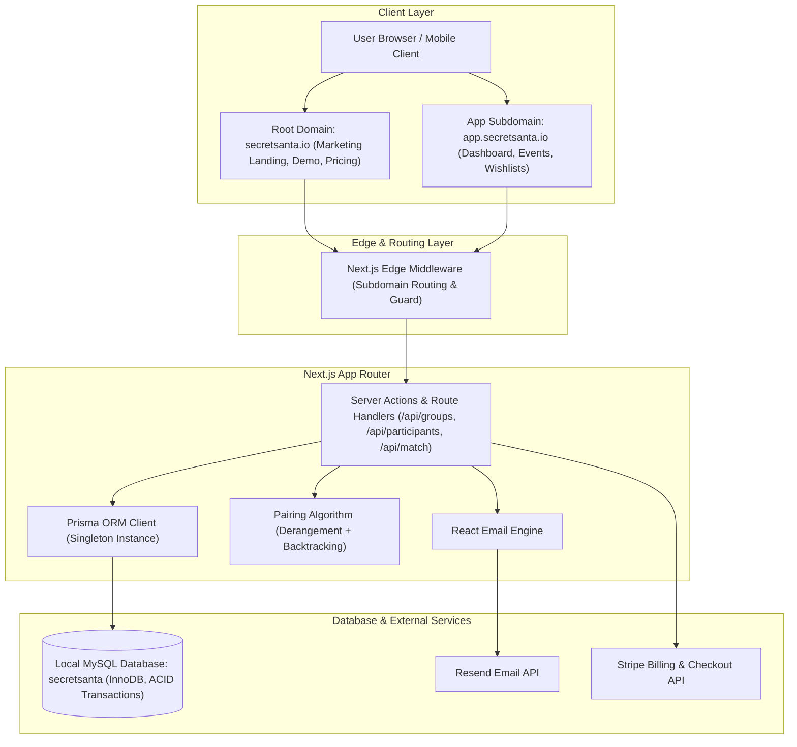

# Product Requirements Document (PRD)
## Secret Santa Organizer Web Application

---

## 1. Executive Summary & Product Vision

### 1.1 Product Overview
The **Secret Santa Organizer** is a modern, responsive, full-stack web application designed to eliminate the logistical hassle of organizing holiday gift exchanges for families, friend groups, and corporate teams. It provides an intuitive, delightful, and privacy-preserving platform for creating events, setting budget and date rules, establishing exclusion constraints (e.g., spouses cannot draw each other), automatically pairing participants with zero spoiler risk, and managing wishlists.

### 1.2 Core Value Proposition
- **Effortless Setup:** Create a gift exchange in under 2 minutes.
- **Fair & Intelligent Matching:** Constraint-aware derangement algorithm ensures nobody draws themselves or their restricted matches (e.g., partners/previous year matches).
- **Anti-Spoiler Security:** Even the organizer cannot view who drew whom without intentionally executing a manual override (with audit logging).
- **Zero-Friction Participant Experience:** Participants don't need a heavy account setup to view their assigned recipient or submit their wishlist—secure magic token links allow instant 1-click reveal with festive animations.
- **Modern Festive SaaS Aesthetic:** Built with the **Inter** font, a consistent **15px border radius**, mobile-first layout, and tasteful seasonal interactions.

---

## 2. System Architecture & Tech Stack



### 2.1 Technology Stack Details

| Layer | Technology | Selection Rationale |
| :--- | :--- | :--- |
| **Framework** | **Next.js (App Router)** | Server Components, Server Actions, route handlers, fast edge middleware for multi-subdomain routing. |
| **Language** | **TypeScript** | Strict mode enabled for end-to-end type safety across database models, APIs, and client components. |
| **Styling** | **Tailwind CSS** | Utility-first styling with custom theme enforcing Inter typography and exact 15px border radii (`rounded-[15px]`). |
| **Database & ORM** | **MySQL + Prisma ORM** | High-performance local relational MySQL database connected via Prisma ORM for type-safe queries, migrations, and ACID transactions. |
| **Email Service** | **Resend + React Email** | High deliverability, type-safe transactional emails with responsive, festive HTML/CSS templates. |
| **Payments** | **Stripe** | Subscriptions and Checkout Sessions for premium tiers (larger groups, custom branding, priority delivery). |
| **Icons & Animation** | **Lucide React + Framer Motion** | Lightweight accessible icons and smooth festive interactive reveal animations. |
| **Testing** | **Vitest, React Testing Library, Playwright** | Fast unit testing for pairing logic, component isolation testing, and end-to-end user flow verification. |

### 2.2 Multi-Domain & Subdomain Routing Strategy

The application adopts a unified Next.js codebase utilizing Edge Middleware (`src/middleware.ts`) to dynamically rewrite hostnames:
1. **Root Domain (`secretsanta.io` / `localhost:3000`)**:
   - Hosts the marketing landing page, social proof, dynamic pricing table, feature breakdown, and SEO metadata.
   - Internal route: `src/app/(marketing)`
2. **App Subdomain (`app.secretsanta.io` / `app.localhost:3000`)**:
   - Hosts the authenticated core SaaS application: event creation wizard, organizer dashboard, participant management, exclusion matrix, drawing controls, and member reveal portal.
   - Internal route: `src/app/(app)`
3. **Dynamic Host Rewrite Logic**:
   - Middleware extracts the `Host` header. If the host starts with `app.`, the request is rewritten to `/(app)/...`. Otherwise, it rewrites to `/(marketing)/...`.
   - Local development is configured using `lvh.me:3000` or custom `hosts` file mappings (`app.localhost:3000` and `localhost:3000`).

---

## 3. UI/UX & Design Guidelines

### 3.1 Strict Design Rules
- **Typography:** **Inter** font family (`font-sans`) exclusively across all headings, body text, buttons, and inputs.
- **Border Radius:** **Strict 15px border radius** (`rounded-[15px]`) applied to:
  - Buttons (`btn`, icon buttons, pills)
  - Cards (containers, event summaries, participant cards)
  - Inputs (text inputs, selects, textareas, checkboxes, toggles)
  - Modals, Dialogs, Bottom Sheets, and Tooltips
  - Notification badges and status pills
- **Responsiveness:** 100% Mobile-first responsive layout (tested on 360px width viewport up to 4K displays).
- **Accessibility:** WCAG 2.1 AA compliance with high-contrast festive tones, accessible focus rings, and full keyboard navigation.

### 3.2 Design System Palette

```css
:root {
  /* Core Brand & Festive Accents */
  --color-pine-900: #0d2818;
  --color-pine-800: #164228;
  --color-pine-600: #2d6a4f;
  --color-crimson-600: #d90429;
  --color-crimson-500: #ef233c;
  --color-gold-500: #e9c46a;
  --color-snow-50: #f8f9fa;
  --color-snow-100: #edf2f4;
  --color-slate-800: #2b2d42;
  --color-slate-900: #181924;

  /* Standard Border Radius Rule */
  --radius-global: 15px;
}
```

---

## 4. User Personas & Detailed User Flows

```mermaid
sequenceDiagram
    autonumber
    actor Organizer as Event Organizer
    actor Participant as Participant
    participant App as App Frontend (app.)
    participant DB as Prisma ORM & MySQL
    participant Mail as Resend API

    Organizer->>App: 1. Sign In / Register or Create Group
    App->>DB: Create / Verify User Record
    Organizer->>App: 2. Create Event (Budget, Exchange Date, Rules)
    App->>DB: Insert Group Record via Prisma
    Organizer->>App: 3. Add Participants & Exclusion Rules
    App->>DB: Insert Participants & Pair Restrictions
    Organizer->>App: 4. Click "Draw Names"
    App->>App: 5. Execute Derangement Algorithm
    App->>DB: Commit Assignments via Prisma $transaction
    App->>Mail: 6. Trigger Resend Transactional Emails
    Mail-->>Participant: 7. Deliver Secret Santa Invitation + Magic Token
    Participant->>App: 8. Open Tokenized Reveal Page
    App-->>Participant: 9. Festive Scratch/Unwrap Animation + Wishlist Details
    Participant->>App: 10. Submit Own Wishlist & Gift Preferences
    App->>DB: Update Wishlist Records in MySQL
```

### 4.1 Persona 1: Event Organizer
1. **Landing & Setup:**
   - Navigates to marketing site -> tests interactive live matching or clicks "Create a Secret Santa" -> routed to the event creator.
   - User account / organizer profile is managed and persisted in local MySQL via Prisma ORM.
2. **Event Creation:**
   - Configures event title (e.g., *"Smith Family Christmas 2026"*), spending limit/currency (e.g., *\$30 USD*), gift exchange date, delivery location (physical address or virtual meet link), and custom message.
3. **Roster & Constraint Setup:**
   - Adds participants manually (Name, Email) or pastes roster.
   - Configures Exclusion Rules (e.g., *"Alice cannot draw Bob"* - spouses / immediate family).
4. **Drawing Names:**
   - Clicks **"Draw Names"**. System validates feasibility of graph matching.
   - Dispatches transactional emails via Resend containing unique, single-use secure reveal links.
   - Real-time delivery status is logged in MySQL `email_logs`.
5. **Event Management:**
   - Send reminders to participants who haven't viewed their assignment or submitted wishlists.

### 4.2 Persona 2: Participant
1. **Notification:**
   - Receives email from Resend: *"You have been invited to Smith Family Christmas 2026!"*
2. **One-Click Magic Access:**
   - Clicks secure token link (no password required).
3. **The Reveal Experience:**
   - Lands on a festive, mobile-optimized gift reveal screen.
   - Interacts with an interactive unwrapping/scratch-off component (built with Framer Motion).
   - Learns who their giftee is alongside their giftee's wishlist, preferred retail links, and allergy/dislike notes.
4. **Wishlist Submission:**
   - Fills in their own 3-item wishlist with URLs and notes for their secret Santa.

### 4.3 Persona 3: Premium User (Stripe Monetization)
1. Free tier supports up to **15 participants** per event with standard email templates.
2. When the organizer attempts to add more than 15 members or select premium festive templates / SMS notifications:
   - Upgrade modal appears with Stripe Checkout integration.
   - Webhook updates the event / user subscription tier in MySQL instantly.

---

## 5. Secret Santa Matching Algorithm

The matching algorithm is implemented in TypeScript using a constrained derangement backtracking engine with cycle detection:

1. **Definitions:**
   - Set of participants $P = \{p_1, p_2, \dots, p_n\}$.
   - Directed graph $G = (V, E)$ where an edge $(p_i, p_j) \in E$ exists if $p_i$ is permitted to give a gift to $p_j$.
   - By definition:
     - Self-giving is forbidden: $(p_i, p_i) \notin E, \forall i$.
     - Explicit exclusions are omitted: $(p_a, p_b) \notin E$ if $(p_a, p_b) \in \text{Restrictions}$.
2. **Objective:**
   - Find a Hamiltonian cycle or a collection of valid disjoint derangements spanning all vertices in $G$ such that in-degree and out-degree of every vertex equals 1.
3. **Backtracking Implementation:**
   - Shuffle candidate list using Fisher-Yates with a cryptographically secure random source (`crypto.getRandomValues`).
   - Recursively assign candidate pairs using Most Constrained Variable (MCV) heuristic.
   - If an impasse occurs (deadlock where remaining participant has no legal matches), backtrack up to 5,000 iterations.
   - If no valid match exists, throw a descriptive `UnsatisfiableExclusionGraphError` indicating which rule combination is impossible.

---

## 6. Database Schema (Prisma ORM & MySQL Relational Models)

The database architecture is powered by **MySQL (InnoDB engine)** managed declaratively via **Prisma ORM**. It guarantees full ACID transaction guarantees (`prisma.$transaction`) during Secret Santa pairings, cascading foreign-key referential integrity, and anti-spoiler shielding.

### 6.1 Prisma Schema Definition (`prisma/schema.prisma`)

```prisma
datasource db {
  provider = "mysql"
}

generator client {
  provider = "prisma-client"
}

enum EventStatus {
  DRAFT
  DRAWN
  COMPLETED
  CANCELLED
}

enum EmailType {
  ASSIGNMENT_REVEAL
  REMINDER
  WISHLIST_UPDATED
}

enum EmailStatus {
  QUEUED
  SENT
  DELIVERED
  FAILED
}

// 1. Users / Organizers
model User {
  id                        String        @id @default(uuid())
  email                     String        @unique
  name                      String?
  avatarUrl                 String?
  stripeCustomerId          String?
  stripeSubscriptionStatus  String?       @default("free")
  createdAt                 DateTime      @default(now())
  updatedAt                 DateTime      @updatedAt

  groups                    Group[]
  participants              Participant[]
  payments                  Payment[]

  @@map("users")
}

// 2. Secret Santa Groups / Events
model Group {
  id              String            @id @default(uuid())
  organizerId     String?
  title           String
  description     String?           @db.Text
  budgetAmount    Decimal?          @db.Decimal(10, 2)
  budgetCurrency  String            @default("USD")
  exchangeDate    DateTime?
  location        String?
  status          EventStatus       @default(DRAFT)
  allowWishlists  Boolean           @default(true)
  isPremium       Boolean           @default(false)
  drawnAt         DateTime?
  createdAt       DateTime          @default(now())
  updatedAt       DateTime          @updatedAt

  organizer       User?             @relation(fields: [organizerId], references: [id], onDelete: SetNull)
  participants    Participant[]
  restrictions    PairRestriction[]
  assignments     Assignment[]
  emailLogs       EmailLog[]
  payments        Payment[]

  @@index([organizerId])
  @@map("groups")
}

// 3. Participants
model Participant {
  id                    String            @id @default(uuid())
  groupId               String
  userId                String?
  name                  String
  email                 String
  inviteToken           String            @unique @default(uuid())
  hasViewedAssignment  Boolean           @default(false)
  viewedAt              DateTime?
  createdAt             DateTime          @default(now())

  group                 Group             @relation(fields: [groupId], references: [id], onDelete: Cascade)
  user                  User?             @relation(fields: [userId], references: [id], onDelete: SetNull)
  
  wishlist              Wishlist?
  givenAssignment       Assignment?       @relation("GiverAssignment")
  receivedAssignment    Assignment?       @relation("ReceiverAssignment")
  
  givenRestrictions     PairRestriction[] @relation("GiverRestriction")
  receivedRestrictions  PairRestriction[] @relation("ReceiverRestriction")
  emailLogs             EmailLog[]

  @@unique([groupId, email])
  @@index([groupId])
  @@index([inviteToken])
  @@map("participants")
}

// 4. Pair Restrictions (Exclusions: e.g. Alice cannot give to Bob)
model PairRestriction {
  id                              String      @id @default(uuid())
  groupId                         String
  giverParticipantId              String
  restrictedReceiverParticipantId String
  createdAt                       DateTime    @default(now())

  group                           Group       @relation(fields: [groupId], references: [id], onDelete: Cascade)
  giver                           Participant @relation("GiverRestriction", fields: [giverParticipantId], references: [id], onDelete: Cascade)
  restrictedReceiver              Participant @relation("ReceiverRestriction", fields: [restrictedReceiverParticipantId], references: [id], onDelete: Cascade)

  @@unique([giverParticipantId, restrictedReceiverParticipantId])
  @@index([groupId])
  @@map("pair_restrictions")
}

// 5. Secret Assignments (Anti-Spoiler Engine)
model Assignment {
  id          String      @id @default(uuid())
  groupId     String
  giverId     String      @unique
  receiverId  String      @unique
  createdAt   DateTime    @default(now())

  group       Group       @relation(fields: [groupId], references: [id], onDelete: Cascade)
  giver       Participant @relation("GiverAssignment", fields: [giverId], references: [id], onDelete: Cascade)
  receiver    Participant @relation("ReceiverAssignment", fields: [receiverId], references: [id], onDelete: Cascade)

  @@index([groupId])
  @@map("assignments")
}

// 6. Wishlist
model Wishlist {
  id             String         @id @default(uuid())
  participantId  String         @unique
  notes          String?        @db.Text
  clothingSizes  String?        @db.Text
  createdAt      DateTime       @default(now())
  updatedAt      DateTime       @updatedAt

  participant    Participant    @relation(fields: [participantId], references: [id], onDelete: Cascade)
  items          WishlistItem[]

  @@map("wishlists")
}

// 7. Wishlist Items
model WishlistItem {
  id              String    @id @default(uuid())
  wishlistId      String
  title           String
  url             String?   @db.Text
  estimatedPrice  Decimal?  @db.Decimal(10, 2)
  priority        Int       @default(1)
  createdAt       DateTime  @default(now())

  wishlist        Wishlist  @relation(fields: [wishlistId], references: [id], onDelete: Cascade)

  @@index([wishlistId])
  @@map("wishlist_items")
}

// 8. Email Delivery Audit Logs
model EmailLog {
  id             String       @id @default(uuid())
  groupId        String
  participantId  String
  resendEmailId  String?
  type           EmailType
  status         EmailStatus  @default(QUEUED)
  errorMessage   String?      @db.Text
  sentAt         DateTime     @default(now())

  group          Group        @relation(fields: [groupId], references: [id], onDelete: Cascade)
  participant    Participant  @relation(fields: [participantId], references: [id], onDelete: Cascade)

  @@index([groupId])
  @@index([participantId])
  @@map("email_logs")
}

// 9. Stripe Subscriptions / Transactions
model Payment {
  id                   String    @id @default(uuid())
  userId               String
  groupId              String?
  stripeSessionId      String    @unique
  stripePaymentIntent  String?
  amountCents          Int
  currency             String    @default("USD")
  status               String
  createdAt            DateTime  @default(now())

  user                 User      @relation(fields: [userId], references: [id], onDelete: Cascade)
  group                Group?    @relation(fields: [groupId], references: [id], onDelete: SetNull)

  @@index([userId])
  @@index([groupId])
  @@map("payments")
}
```

---

## 7. Complete Folder Structure

```
christmas/
├── .env.example
├── .gitignore
├── package.json
├── tsconfig.json
├── tailwind.config.ts
├── postcss.config.mjs
├── next.config.ts
├── vitest.config.ts
├── playwright.config.ts
├── prd.md
├── public/
│   ├── favicon.ico
│   ├── og-image.png
│   └── illustrations/
│       ├── gift-box.svg
│       └── santa-hat.svg
├── src/
│   ├── middleware.ts                 # Subdomain rewriting (root vs app.)
│   ├── app/
│   │   ├── (marketing)/              # Root domain: secretsanta.io
│   │   │   ├── layout.tsx
│   │   │   ├── page.tsx              # Landing page
│   │   │   ├── pricing/
│   │   │   │   └── page.tsx
│   │   │   └── faq/
│   │   │       └── page.tsx
│   │   ├── (app)/                    # App subdomain: app.secretsanta.io
│   │   │   ├── layout.tsx
│   │   │   ├── (auth)/
│   │   │   │   ├── login/page.tsx
│   │   │   │   └── callback/route.ts
│   │   │   ├── dashboard/
│   │   │   │   ├── page.tsx          # Events list
│   │   │   │   └── loading.tsx
│   │   │   ├── events/
│   │   │   │   ├── new/page.tsx      # Create event wizard
│   │   │   │   └── [id]/
│   │   │   │       ├── page.tsx      # Event overview & metrics
│   │   │   │       ├── participants/page.tsx
│   │   │   │       ├── rules/page.tsx # Exclusion matrix
│   │   │   │       └── draw/page.tsx  # Drawing confirmation & actions
│   │   │   ├── reveal/
│   │   │   │   └── [token]/
│   │   │   │       ├── page.tsx      # Token-protected participant reveal
│   │   │   │       └── wishlist/page.tsx
│   │   │   └── settings/
│   │   │       └── billing/page.tsx
│   │   └── api/
│   │       ├── groups/
│   │       │   ├── route.ts          # Group CRUD & transaction draw (GET, POST)
│   │       │   └── [id]/route.ts     # Single group details & delete (GET, DELETE)
│   │       ├── participants/
│   │       │   └── route.ts          # Participant management (GET, POST)
│   │       ├── match/
│   │       │   └── route.ts          # Real-time Derangement solver & MySQL commit (GET, POST)
│   │       ├── health/
│   │       │   └── db/route.ts       # Database connectivity health check (GET)
│   │       └── webhooks/
│   │           ├── stripe/route.ts   # Stripe checkout & subscription handler
│   │           └── resend/route.ts   # Email delivery status webhooks
│   ├── components/
│   │   ├── ui/                       # Strict 15px radius, Inter font
│   │   │   ├── button.tsx
│   │   │   ├── card.tsx
│   │   │   ├── input.tsx
│   │   │   ├── dialog.tsx
│   │   │   ├── dropdown-menu.tsx
│   │   │   ├── badge.tsx
│   │   │   └── toast.tsx
│   │   ├── festive/
│   │   │   ├── scratch-reveal.tsx    # Interactive canvas scratch card
│   │   │   ├── gift-box-unfold.tsx   # Framer Motion 3D gift box
│   │   │   └── snow-effect.tsx       # Subtle CSS canvas snowfall
│   │   ├── marketing/
│   │   │   ├── hero.tsx
│   │   │   ├── features.tsx
│   │   │   ├── how-it-works.tsx
│   │   │   ├── pricing-section.tsx
│   │   │   ├── faq-section.tsx
│   │   │   ├── cta-banner.tsx
│   │   │   └── footer.tsx
│   │   └── app/
│   │       ├── participant-form.tsx
│   │       ├── exclusion-matrix.tsx
│   │       ├── draw-status-pill.tsx
│   │       └── wishlist-editor.tsx
│   ├── emails/                       # React Email Templates
│   │   ├── assignment-reveal.tsx
│   │   ├── draw-reminder.tsx
│   │   └── components/
│   │       ├── email-header.tsx
│   │       └── email-button.tsx
│   ├── lib/
│   │   ├── prisma.ts                 # Prisma Client Singleton (MySQL connection pool)
│   │   ├── algorithms/
│   │   │   ├── derangement.ts        # Secret Santa matching solver
│   │   │   └── validation.ts
│   │   ├── resend.ts                 # Resend SDK client
│   │   ├── stripe.ts                 # Stripe SDK client & price IDs
│   │   ├── utils.ts                  # cn, formatting helpers
│   │   └── validations/              # Zod schemas
│   │       ├── event.schema.ts
│   │       ├── participant.schema.ts
│   │       └── wishlist.schema.ts
│   └── types/
│       ├── app.types.ts
│       └── event.types.ts
├── prisma/
│   └── schema.prisma                 # Declarative MySQL Schema
└── tests/
    ├── unit/
    │   ├── derangement.test.ts       # Algorithm stress tests
    │   ├── prisma-connection.test.ts # Database health and client tests
    │   └── stripe-resend.test.ts
    ├── components/
    │   ├── marketing.test.tsx
    │   └── ui.test.tsx
    └── e2e/
        ├── event-creation-flow.test.tsx
        └── server-action-flow.test.ts
```

---

## 8. Resend Email Integration & Templates

### 8.1 Transactional Email Pipeline
Emails are triggered via Next.js Server Actions / API Routes utilizing the Resend API with React Email templates:
1. **Assignment Notification Email:**
   - Subject: `🎁 Your Secret Santa assignment for [Event Name]!`
   - Content: Festive greeting, spending limit badge, exchange date, and a high-contrast CTA button pointing to `https://app.secretsanta.io/reveal/[unique_invite_token]`.
2. **Wishlist Updated Email:**
   - Sent to the Secret Santa when their assigned recipient adds items to their wishlist.
3. **Nudge Reminder Email:**
   - Sent 72 hours before the exchange date if the participant has not viewed their match.

---

## 9. Stripe Billing Architecture (Premium Tiers)

### 9.1 Tier Comparison

| Feature | Free Tier | Premium Holiday Pass (\$9.99 / event or \$29 / year) |
| :--- | :--- | :--- |
| Max Participants | Up to 15 | Unlimited |
| Exclusion Rules | Up to 5 | Unlimited |
| Email Templates | Standard Modern | Festive Animations & Custom Branding |
| SMS Notifications | ❌ | ✅ via Twilio integration |
| Delivery Tracking | Basic | Real-time Open & Reveal Tracking |
| Audit History | Current Year | Multi-year historical archives |

### 9.2 Webhook Handling
- `checkout.session.completed`: Upgrades the target `groupId` or `userId` to premium status in MySQL.
- `customer.subscription.deleted`: Gracefully reverts organization features back to standard limits.

---

## 10. Testing & Quality Assurance Plan

### 10.1 Unit Testing (Vitest)
- **Matching Algorithm Constraints:**
  - 100% test coverage for the derangement algorithm.
  - Stress test with 1,000 randomized participant groups and varying exclusion matrices.
  - Ensure zero self-matches and zero exclusion collisions.
  - Test graceful error handling on impossible graph constraints (e.g., 2 people excluding each other in a 2-person group).
- **Prisma & Database Connection Testing:**
  - Tests database client instantiation, query delegate availability, and diagnostic health check endpoint.

### 10.2 Component & Style Regression Testing
- Verify all interactive controls strictly render `border-radius: 15px`.
- Accessibility testing and mobile viewport responsiveness.

### 10.3 End-to-End (E2E) Testing (Playwright / Vitest)
- Flow 1: Create an event -> Add participants -> Configure exclusions -> Draw names.
- Flow 2: Access invite link -> Scratch/reveal assignment -> Add items to wishlist.
- Flow 3: Stripe checkout flow in test mode.

---

## 11. Security, Privacy & Compliance

1. **Relational Data Integrity:** ACID transactions via `prisma.$transaction` ensure atomic commits for group draws and pairings.
2. **Anti-Spoiler Protections:** The `assignments` table is shielded from organizer snooping; participants only query their specific assignment through their unguessable `inviteToken`.
3. **Environment Security:** Resend API keys, Database credentials, and Stripe Secret keys are restricted exclusively to server-side executions.
4. **Input Sanitization:** All payload inputs are verified and stripped using strict Zod schemas.

---

## 12. Implementation Roadmap

- [x] **Phase 1: Architecture & PRD Generation** (Updated for MySQL + Prisma)
- [x] **Phase 2: Project Scaffolding & Design System Foundations**
  - Next.js 15, TypeScript, Tailwind CSS with 15px radius tokens, Inter font setup.
  - Base components (Button, Input, Card, Modal).
- [x] **Phase 3: MySQL & Prisma ORM Integration**
  - Database schema, migrations/db push, Prisma client singleton, API CRUD routes.
- [x] **Phase 4: Derangement Algorithm & Event Creation Flow**
  - Backtracking matching algorithm with comprehensive Vitest suite.
  - Participant management & exclusion matrix UI.
- [x] **Phase 5: Email Automation (Resend) & Reveal Flow**
  - React Email templates, token verification, assignment reveal flow.
- [x] **Phase 6: Marketing Landing Page & Live Interactive Solver**
  - Responsive marketing landing page connected live to Prisma MySQL backend.
- [x] **Phase 7: End-to-End Testing & Verification**
  - Complete test suite, database health verification, zero vulnerabilities.
