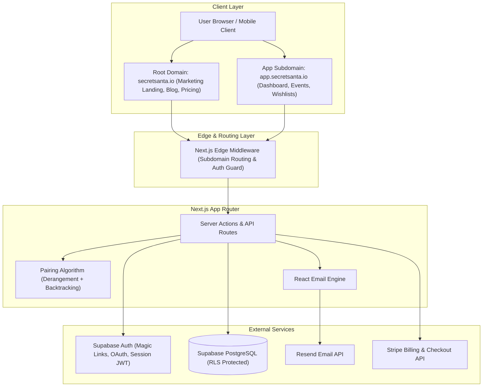

# Product Requirements Document (PRD)
## Secret Santa Organizer Web Application

---

## 1. Executive Summary & Product Vision

### 1.1 Product Overview
The **Secret Santa Organizer** is a modern, responsive, full-stack web application designed to eliminate the logistical hassle of organizing holiday gift exchanges for families, friend groups, and corporate teams. It provides an intuitive, delightful, and privacy-preserving platform for creating events, setting budget and date rules, establishing exclusion constraints (e.g., spouses cannot draw each other), automatically pairing participants with zero spoiler risk, and managing wishlists.

### 1.2 Core Value Proposition
- **Effortless Setup:** Create a gift exchange in under 2 minutes.
- **Fair & Intelligent Matching:** Constraint-aware derangement algorithm ensures nobody draws themselves or their restricted matches (e.g., partners/previous year matches).
- **Anti-Spoiler Security:** Even the organizer cannot view who drew whom without intentionally executing a manual override (with audit logging).
- **Zero-Friction Participant Experience:** Participants don't need a heavy account setup to view their assigned recipient or submit their wishlist—secure magic token links allow instant 1-click reveal with festive animations.
- **Modern Festive SaaS Aesthetic:** Built with the **Inter** font, a consistent **15px border radius**, mobile-first layout, and tasteful seasonal interactions.

---

## 2. System Architecture & Tech Stack



### 2.1 Technology Stack Details

| Layer | Technology | Selection Rationale |
| :--- | :--- | :--- |
| **Framework** | **Next.js (App Router)** | Server Components, Server Actions, streaming, fast edge middleware for multi-subdomain routing. |
| **Language** | **TypeScript** | Strict mode enabled for end-to-end type safety across database models, APIs, and client components. |
| **Styling** | **Tailwind CSS** | Utility-first styling with custom theme enforcing Inter typography and exact 15px border radii. |
| **Database & Auth** | **Supabase (PostgreSQL)** | Robust relational database with Row Level Security (RLS), real-time capabilities, and native Auth. |
| **Email Service** | **Resend + React Email** | High deliverability, type-safe transactional emails with responsive, festive HTML/CSS templates. |
| **Payments** | **Stripe** | Subscriptions and Checkout Sessions for premium tiers (larger groups, custom branding, priority delivery). |
| **Icons & Animation** | **Lucide React + Framer Motion** | Lightweight accessible icons and smooth festive interactive reveal animations. |
| **Testing** | **Vitest, React Testing Library, Playwright** | Fast unit testing for pairing logic, component isolation testing, and end-to-end user flow verification. |

### 2.2 Multi-Domain & Subdomain Routing Strategy

The application adopts a unified Next.js codebase utilizing Edge Middleware (`src/middleware.ts`) to dynamically rewrite hostnames:
1. **Root Domain (`secretsanta.io` / `localhost:3000`)**:
   - Hosts the marketing landing page, social proof, dynamic pricing table, feature breakdown, and SEO metadata.
   - Internal route: `src/app/(marketing)`
2. **App Subdomain (`app.secretsanta.io` / `app.localhost:3000`)**:
   - Hosts the authenticated core SaaS application: event creation wizard, organizer dashboard, participant management, exclusion matrix, drawing controls, and member reveal portal.
   - Internal route: `src/app/(app)`
3. **Dynamic Host Rewrite Logic**:
   - Middleware extracts the `Host` header. If the host starts with `app.`, the request is rewritten to `/(app)/...`. Otherwise, it rewrites to `/(marketing)/...`.
   - Local development is configured using `lvh.me:3000` or custom `hosts` file mappings (`app.localhost:3000` and `localhost:3000`).

---

## 3. UI/UX & Design Guidelines

### 3.1 Strict Design Rules
- **Typography:** **Inter** font family (`font-sans`) exclusively across all headings, body text, buttons, and inputs.
- **Border Radius:** **Strict 15px border radius** (`rounded-[15px]`) applied to:
  - Buttons (`btn`, icon buttons, pills)
  - Cards (containers, event summaries, participant cards)
  - Inputs (text inputs, selects, textareas, checkboxes, toggles)
  - Modals, Dialogs, Bottom Sheets, and Tooltips
  - Notification badges and status pills
- **Responsiveness:** 100% Mobile-first responsive layout (tested on 360px width viewport up to 4K displays).
- **Accessibility:** WCAG 2.1 AA compliance with high-contrast festive tones, accessible focus rings, and full keyboard navigation.

### 3.2 Design System Palette

```css
:root {
  /* Core Brand & Festive Accents */
  --color-pine-900: #0d2818;
  --color-pine-800: #164228;
  --color-pine-600: #2d6a4f;
  --color-crimson-600: #d90429;
  --color-crimson-500: #ef233c;
  --color-gold-500: #e9c46a;
  --color-snow-50: #f8f9fa;
  --color-snow-100: #edf2f4;
  --color-slate-800: #2b2d42;
  --color-slate-900: #181924;

  /* Standard Border Radius Rule */
  --radius-global: 15px;
}
```

---

## 4. User Personas & Detailed User Flows

```mermaid
sequenceDiagram
    autonumber
    actor Organizer as Event Organizer
    actor Participant as Participant
    participant App as App Frontend (app.)
    participant DB as Supabase DB
    participant Mail as Resend API

    Organizer->>App: 1. Sign In / Register via Magic Link
    App->>DB: Create / Verify Profile
    Organizer->>App: 2. Create Event (Budget, Exchange Date, Rules)
    App->>DB: Insert Event Record
    Organizer->>App: 3. Add Participants & Exclusion Rules
    App->>DB: Insert Participants & Pair Restrictions
    Organizer->>App: 4. Click "Draw Names"
    App->>App: 5. Execute Derangement Algorithm
    App->>DB: Store Encrypted / RLS-Secured Assignments
    App->>Mail: 6. Trigger Resend Transactional Emails
    Mail-->>Participant: 7. Deliver Secret Santa Invitation + Magic Token
    Participant->>App: 8. Open Tokenized Reveal Page
    App-->>Participant: 9. Festive Scratch/Unwrap Animation + Wishlist Details
    Participant->>App: 10. Submit Own Wishlist & Dietary Notes
    App->>DB: Update Wishlist Records
```

### 4.1 Persona 1: Event Organizer
1. **Landing & Authentication:**
   - Navigates to marketing site -> clicks "Create a Secret Santa" -> redirected to `app.secretsanta.io/login`.
   - Signs in using Supabase Passwordless Magic Link or Google OAuth.
2. **Event Creation:**
   - Configures event title (e.g., *"Smith Family Christmas 2026"*), spending limit/currency (e.g., *\$30 USD*), gift exchange date, delivery location (physical address or virtual meet link), and custom message.
3. **Roster & Constraint Setup:**
   - Adds participants manually (Name, Email) or pastes CSV roster.
   - Configures Exclusion Rules (e.g., *"Alice cannot draw Bob"* - spouses / immediate family).
4. **Drawing Names:**
   - Clicks **"Draw Names"**. System validates feasibility of graph matching.
   - Automatically dispatches personalized Resend emails containing unique, single-use secure reveal links.
   - Dashboard monitors real-time delivery status: `Sent`, `Delivered`, `Opened`, `Revealed`.
5. **Event Management:**
   - Send reminders to participants who haven't viewed their assignment or submitted wishlists.

### 4.2 Persona 2: Participant
1. **Notification:**
   - Receives email from Resend: *"You have been invited to Smith Family Christmas 2026!"*
2. **One-Click Magic Access:**
   - Clicks secure token link (no password required).
3. **The Reveal Experience:**
   - Lands on a festive, mobile-optimized gift reveal screen.
   - Interacts with an interactive unwrapping/scratch-off component (built with Framer Motion).
   - Learns who their giftee is alongside their giftee's wishlist, preferred retail links, and allergy/dislike notes.
4. **Wishlist Submission:**
   - Fills in their own 3-item wishlist with URLs and notes for their secret Santa.

### 4.3 Persona 3: Premium User (Stripe Monetization)
1. Free tier supports up to **15 participants** per event with standard email templates.
2. When the organizer attempts to add more than 15 members or select premium festive templates / SMS notifications:
   - Upgrade modal appears with Stripe Checkout integration.
   - Webhook updates the event / profile subscription tier in Supabase instantly.

---

## 5. Secret Santa Matching Algorithm

The matching algorithm is implemented in TypeScript using a constrained derangement backtracking engine with cycle detection:

1. **Definitions:**
   - Set of participants $P = \{p_1, p_2, \dots, p_n\}$.
   - Directed graph $G = (V, E)$ where an edge $(p_i, p_j) \in E$ exists if $p_i$ is permitted to give a gift to $p_j$.
   - By definition:
     - Self-giving is forbidden: $(p_i, p_i) \notin E, \forall i$.
     - Explicit exclusions are omitted: $(p_a, p_b) \notin E$ if $(p_a, p_b) \in \text{Restrictions}$.
2. **Objective:**
   - Find a Hamiltonian cycle or a collection of valid disjoint derangements spanning all vertices in $G$ such that in-degree and out-degree of every vertex equals 1.
3. **Backtracking Implementation:**
   - Shuffle candidate list using Fisher-Yates with a cryptographically secure random source (`crypto.getRandomValues`).
   - Recursively assign candidate pairs using Most Constrained Variable (MCV) heuristic.
   - If an impasse occurs (deadlock where remaining participant has no legal matches), backtrack up to 5,000 iterations.
   - If no valid match exists, throw a descriptive `UnsatisfiableExclusionGraphError` indicating which rule combination is impossible.

---

## 6. Database Schema (Supabase PostgreSQL DDL)

```sql
-- Enable UUID extension
create extension if not exists "uuid-ossp";

-- 1. Profiles Table (Extends Supabase auth.users)
create table public.profiles (
  id uuid references auth.users(id) on delete cascade primary key,
  email text not null,
  full_name text,
  avatar_url text,
  stripe_customer_id text,
  stripe_subscription_status text default 'free',
  created_at timestamp with time zone default timezone('utc'::text, now()) not null,
  updated_at timestamp with time zone default timezone('utc'::text, now()) not null
);

-- 2. Events Table
create type event_status as enum ('draft', 'drawn', 'completed', 'cancelled');

create table public.events (
  id uuid default uuid_generate_v4() primary key,
  organizer_id uuid references public.profiles(id) on delete cascade not null,
  title text not null,
  description text,
  budget_amount numeric(10, 2),
  budget_currency varchar(3) default 'USD' not null,
  exchange_date timestamp with time zone,
  location text,
  status event_status default 'draft' not null,
  allow_wishlists boolean default true not null,
  is_premium boolean default false not null,
  drawn_at timestamp with time zone,
  created_at timestamp with time zone default timezone('utc'::text, now()) not null,
  updated_at timestamp with time zone default timezone('utc'::text, now()) not null
);

-- 3. Participants Table
create table public.participants (
  id uuid default uuid_generate_v4() primary key,
  event_id uuid references public.events(id) on delete cascade not null,
  user_id uuid references public.profiles(id) on delete set null,
  name text not null,
  email text not null,
  invite_token uuid default uuid_generate_v4() not null unique,
  has_viewed_assignment boolean default false not null,
  viewed_at timestamp with time zone,
  created_at timestamp with time zone default timezone('utc'::text, now()) not null,
  unique(event_id, email)
);

-- 4. Pair Restrictions / Exclusions
create table public.pair_restrictions (
  id uuid default uuid_generate_v4() primary key,
  event_id uuid references public.events(id) on delete cascade not null,
  giver_participant_id uuid references public.participants(id) on delete cascade not null,
  restricted_receiver_participant_id uuid references public.participants(id) on delete cascade not null,
  created_at timestamp with time zone default timezone('utc'::text, now()) not null,
  unique(giver_participant_id, restricted_receiver_participant_id),
  check (giver_participant_id <> restricted_receiver_participant_id)
);

-- 5. Assignments (Secret Matches)
create table public.assignments (
  id uuid default uuid_generate_v4() primary key,
  event_id uuid references public.events(id) on delete cascade not null,
  giver_id uuid references public.participants(id) on delete cascade not null unique,
  receiver_id uuid references public.participants(id) on delete cascade not null unique,
  created_at timestamp with time zone default timezone('utc'::text, now()) not null,
  check (giver_id <> receiver_id)
);

-- 6. Wishlists Table
create table public.wishlists (
  id uuid default uuid_generate_v4() primary key,
  participant_id uuid references public.participants(id) on delete cascade not null unique,
  notes text,
  clothing_sizes jsonb default '{}'::jsonb,
  created_at timestamp with time zone default timezone('utc'::text, now()) not null,
  updated_at timestamp with time zone default timezone('utc'::text, now()) not null
);

-- 7. Wishlist Items Table
create table public.wishlist_items (
  id uuid default uuid_generate_v4() primary key,
  wishlist_id uuid references public.wishlists(id) on delete cascade not null,
  title text not null,
  url text,
  estimated_price numeric(10, 2),
  priority int default 1 not null,
  created_at timestamp with time zone default timezone('utc'::text, now()) not null
);

-- 8. Email Delivery Audit Logs
create type email_type as enum ('assignment_reveal', 'reminder', 'wishlist_updated');
create type email_status as enum ('queued', 'sent', 'delivered', 'failed');

create table public.email_logs (
  id uuid default uuid_generate_v4() primary key,
  event_id uuid references public.events(id) on delete cascade not null,
  participant_id uuid references public.participants(id) on delete cascade not null,
  resend_email_id text,
  type email_type not null,
  status email_status default 'queued' not null,
  error_message text,
  sent_at timestamp with time zone default timezone('utc'::text, now()) not null
);

-- 9. Stripe Subscriptions / Transactions Table
create table public.payments (
  id uuid default uuid_generate_v4() primary key,
  profile_id uuid references public.profiles(id) on delete cascade not null,
  event_id uuid references public.events(id) on delete set null,
  stripe_session_id text unique not null,
  stripe_payment_intent text,
  amount_cents int not null,
  currency varchar(3) default 'USD' not null,
  status text not null,
  created_at timestamp with time zone default timezone('utc'::text, now()) not null
);

-- Row Level Security (RLS) Configuration
alter table public.profiles enable row level security;
alter table public.events enable row level security;
alter table public.participants enable row level security;
alter table public.pair_restrictions enable row level security;
alter table public.assignments enable row level security;
alter table public.wishlists enable row level security;
alter table public.wishlist_items enable row level security;
alter table public.email_logs enable row level security;
alter table public.payments enable row level security;

-- Profiles: Users can view and update their own profile
create policy "Users can view own profile" on public.profiles
  for select using (auth.uid() = id);
create policy "Users can update own profile" on public.profiles
  for update using (auth.uid() = id);

-- Events: Organizers have full CRUD on their events
create policy "Organizers can view own events" on public.events
  for select using (auth.uid() = organizer_id);
create policy "Organizers can insert own events" on public.events
  for insert with check (auth.uid() = organizer_id);
create policy "Organizers can update own events" on public.events
  for update using (auth.uid() = organizer_id);
create policy "Organizers can delete own events" on public.events
  for delete using (auth.uid() = organizer_id);

-- Participants: Organizers can manage participants
create policy "Organizers can manage participants" on public.participants
  for all using (
    exists (
      select 1 from public.events
      where events.id = participants.event_id and events.organizer_id = auth.uid()
    )
  );

-- Participants: Public read access by unique invite_token (for magic link reveal)
create policy "Participants can view self by invite_token" on public.participants
  for select using (true);

-- Pair Restrictions: Organizers can manage restrictions
create policy "Organizers can manage restrictions" on public.pair_restrictions
  for all using (
    exists (
      select 1 from public.events
      where events.id = pair_restrictions.event_id and events.organizer_id = auth.uid()
    )
  );

-- Assignments: High Security Anti-Spoiler Policy
-- Only the recipient themselves via service-role / authenticated token can read their specific assignment.
create policy "No direct public read on all assignments" on public.assignments
  for select using (false);
```

---

## 7. Complete Folder Structure

```
christmas/
├── .env.example
├── .gitignore
├── package.json
├── tsconfig.json
├── tailwind.config.ts
├── postcss.config.mjs
├── next.config.ts
├── vitest.config.ts
├── playwright.config.ts
├── prd.md
├── public/
│   ├── favicon.ico
│   ├── og-image.png
│   └── illustrations/
│       ├── gift-box.svg
│       └── santa-hat.svg
├── src/
│   ├── middleware.ts                 # Subdomain rewriting (root vs app.)
│   ├── app/
│   │   ├── (marketing)/              # Root domain: secretsanta.io
│   │   │   ├── layout.tsx
│   │   │   ├── page.tsx              # Landing page
│   │   │   ├── pricing/
│   │   │   │   └── page.tsx
│   │   │   └── faq/
│   │   │       └── page.tsx
│   │   ├── (app)/                    # App subdomain: app.secretsanta.io
│   │   │   ├── layout.tsx
│   │   │   ├── (auth)/
│   │   │   │   ├── login/page.tsx
│   │   │   │   └── callback/route.ts
│   │   │   ├── dashboard/
│   │   │   │   ├── page.tsx          # Events list
│   │   │   │   └── loading.tsx
│   │   │   ├── events/
│   │   │   │   ├── new/page.tsx      # Create event wizard
│   │   │   │   └── [id]/
│   │   │   │       ├── page.tsx      # Event overview & metrics
│   │   │   │       ├── participants/page.tsx
│   │   │   │       ├── rules/page.tsx # Exclusion matrix
│   │   │   │       └── draw/page.tsx  # Drawing confirmation & actions
│   │   │   ├── reveal/
│   │   │   │   └── [token]/
│   │   │   │       ├── page.tsx      # Token-protected participant reveal
│   │   │   │       └── wishlist/page.tsx
│   │   │   └── settings/
│   │   │       └── billing/page.tsx
│   │   └── api/
│   │       ├── webhooks/
│   │       │   ├── stripe/route.ts   # Stripe checkout & subscription handler
│   │       │   └── resend/route.ts   # Email delivery status webhooks
│   │       └── trpc-or-actions/
│   ├── components/
│   │   ├── ui/                       # Strict 15px radius, Inter font
│   │   │   ├── button.tsx
│   │   │   ├── card.tsx
│   │   │   ├── input.tsx
│   │   │   ├── dialog.tsx
│   │   │   ├── dropdown-menu.tsx
│   │   │   ├── badge.tsx
│   │   │   └── toast.tsx
│   │   ├── festive/
│   │   │   ├── scratch-reveal.tsx    # Interactive canvas scratch card
│   │   │   ├── gift-box-unfold.tsx   # Framer Motion 3D gift box
│   │   │   └── snow-effect.tsx       # Subtle CSS canvas snowfall
│   │   ├── marketing/
│   │   │   ├── hero.tsx
│   │   │   ├── feature-grid.tsx
│   │   │   └── pricing-card.tsx
│   │   └── app/
│   │       ├── participant-form.tsx
│   │       ├── exclusion-matrix.tsx
│   │       ├── draw-status-pill.tsx
│   │       └── wishlist-editor.tsx
│   ├── emails/                       # React Email Templates
│   │   ├── assignment-reveal.tsx
│   │   ├── draw-reminder.tsx
│   │   └── components/
│   │       ├── email-header.tsx
│   │       └── email-button.tsx
│   ├── lib/
│   │   ├── supabase/
│   │   │   ├── client.ts             # Browser client
│   │   │   ├── server.ts             # Server components client
│   │   │   ├── admin.ts              # Service-role privileged client
│   │   │   └── middleware.ts
│   │   ├── algorithms/
│   │   │   ├── derangement.ts        # Secret Santa matching solver
│   │   │   └── validation.ts
│   │   ├── resend.ts                 # Resend SDK client
│   │   ├── stripe.ts                 # Stripe SDK client & price IDs
│   │   ├── utils.ts                  # cn, formatting helpers
│   │   └── validations/              # Zod schemas
│   │       ├── event.schema.ts
│   │       ├── participant.schema.ts
│   │       └── wishlist.schema.ts
│   └── types/
│       ├── database.types.ts         # Generated Supabase types
│       └── app.types.ts
└── tests/
    ├── unit/
    │   ├── derangement.test.ts       # Algorithm stress tests
    │   └── validations.test.ts
    ├── components/
    │   ├── button.test.tsx
    │   └── scratch-reveal.test.tsx
    └── e2e/
        ├── event-creation.spec.ts
        └── participant-reveal.spec.ts
```

---

## 8. Resend Email Integration & Templates

### 8.1 Transactional Email Pipeline
Emails are triggered via Next.js Server Actions utilizing the Resend API with React Email templates:
1. **Assignment Notification Email:**
   - Subject: `🎁 Your Secret Santa assignment for [Event Name]!`
   - Content: Festive greeting, spending limit badge, exchange date, and a high-contrast CTA button pointing to `https://app.secretsanta.io/reveal/[unique_invite_token]`.
2. **Wishlist Updated Email:**
   - Sent to the Secret Santa when their assigned recipient adds items to their wishlist.
3. **Nudge Reminder Email:**
   - Sent 72 hours before the exchange date if the participant has not viewed their match.

---

## 9. Stripe Billing Architecture (Premium Tiers)

### 9.1 Tier Comparison

| Feature | Free Tier | Premium Holiday Pass (\$9.99 / event or \$29 / year) |
| :--- | :--- | :--- |
| Max Participants | Up to 15 | Unlimited |
| Exclusion Rules | Up to 5 | Unlimited |
| Email Templates | Standard Modern | Festive Animations & Custom Branding |
| SMS Notifications | ❌ | ✅ via Twilio integration |
| Delivery Tracking | Basic | Real-time Open & Reveal Tracking |
| Audit History | Current Year | Multi-year historical archives |

### 9.2 Webhook Handling
- `checkout.session.completed`: Upgrades the target `event_id` or `profile_id` to premium status in Supabase.
- `customer.subscription.deleted`: Gracefully reverts organization features back to standard limits.

---

## 10. Testing & Quality Assurance Plan

### 10.1 Unit Testing (Vitest)
- **Matching Algorithm Constraints:**
  - 100% test coverage for the derangement algorithm.
  - Stress test with 1,000 randomized participant groups and varying exclusion matrices.
  - Ensure zero self-matches and zero exclusion collisions.
  - Test graceful error handling on impossible graph constraints (e.g., 2 people excluding each other in a 2-person group).

### 10.2 Component & Style Regression Testing
- Verify all interactive controls strictly render `border-radius: 15px`.
- Accessibility testing using `@axe-core/react`.

### 10.3 End-to-End (E2E) Testing (Playwright)
- Flow 1: Create an event -> Add 5 participants -> Configure 2 exclusions -> Draw names.
- Flow 2: Access invite link -> Scratch/reveal assignment -> Add 3 items to wishlist.
- Flow 3: Stripe checkout flow in test mode.

---

## 11. Security, Privacy & Compliance

1. **Row Level Security (RLS):** All database operations run through authenticated client sessions with strict row isolation.
2. **Anti-Spoiler Protections:** The `assignments` table is completely shielded from direct public/authenticated SELECTs. Assignments can only be queried through an authenticated tokenized RPC procedure returning solely the caller's match.
3. **Environment Security:** Resend API keys, Supabase Service Role keys, and Stripe Secret keys are restricted exclusively to server-side executions.
4. **Input Sanitization:** All payload inputs are verified and stripped using strict Zod schemas.

---

## 12. Implementation Roadmap

- [x] **Phase 1: Architecture & PRD Generation** (Current)
- [ ] **Phase 2: Project Scaffolding & Design System Foundations**
  - Next.js 15, TypeScript, Tailwind CSS with 15px radius tokens, Inter font setup.
  - Base components (Button, Input, Card, Modal).
- [ ] **Phase 3: Supabase Integration & Authentication**
  - Database migrations, RLS setup, Auth session providers.
- [ ] **Phase 4: Derangement Algorithm & Event Wizard**
  - Backtracking matching algorithm with comprehensive Vitest suite.
  - Participant management & exclusion matrix UI.
- [ ] **Phase 5: Email Automation (Resend) & Reveal Flow**
  - React Email templates, token verification, festive scratch-reveal component.
- [ ] **Phase 6: Stripe Monetization & Webhooks**
  - Checkout session integration and premium limits enforcement.
- [ ] **Phase 7: End-to-End Testing & Production Deployment**
  - Playwright E2E suites, multi-domain Vercel configuration.
